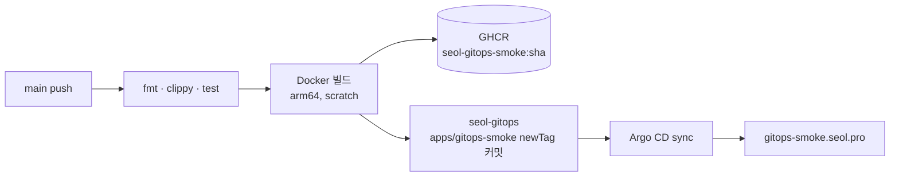

# seol-gitops-smoke

[seol-gitops](https://github.com/Seol-JY/seol-gitops) 클러스터 구성과 CI/CD 파이프라인을 검증하는 스모크 테스트 서버. Rust(tokio, axum), `GET /` 에 `pong` 응답

## 동작

| 경로 | 응답 |
|---|---|
| `GET /` | `pong` |
| `GET /healthz` | `ok` (readiness/liveness probe) |

포트는 `PORT` 환경변수, 기본 8080. SIGTERM 수신 시 graceful shutdown

## 로컬

```bash
cargo run                # http://localhost:8080
cargo test
docker build -t smoke . && docker run --rm -p 8080:8080 smoke
```

## 배포 흐름



- 이미지 태그는 커밋 short SHA, `latest` 도 함께 push
- `deploy` 잡은 `GITOPS_DEPLOY_KEY`(seol-gitops 쓰기용 deploy key, Actions Secret)로 태그 갱신 커밋
- 매니페스트는 seol-gitops 의 `apps/gitops-smoke/`
